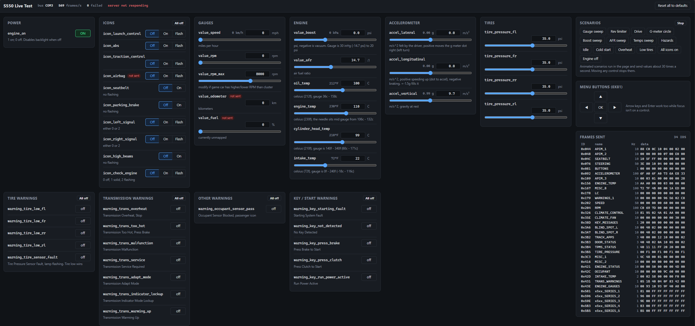

# Changelog

## [2.6.2] - 13 Nov 2026
**The service-required frames aren't the wrench.** Sending the three candidate IDs the manual points to
(`0x168 0x263 0x4A2`) made no difference, and the wrench returns the instant the cluster is power-cycled —
so it's a default-on state, not a latched fault. Next leads are in TODO.md.

### Wrench / See Manual

- Bench test: the three candidate service-required frames sent together — no change on the cluster
- TODO.md: recorded the result and the next steps to chase it down

### Housekeeping

- Moved the `dtc_*.txt` working logs out of the repo root into `logs/` (closes the TODO note about them)
- `.gitignore`: keep local-only material (vendor firmware and other not-for-publish working files) out of the repo

## [2.6.1] - 12 Nov 2026
**The wrench has a lead.** Forscan confirms the bench cluster has no DTCs with the 2.6.0 heartbeat, and the wrench /
See Manual is still on. The workshop manual says it defaults on when the transmission, engine or body service required
message is missing for 5 s, which is when it shows after power up. Which frames the 2015 cluster reads them from isn't
found yet (see TODO.md).

### ipc_dtc_test.py

- `supported`: every code the cluster can set (UDS `19 0A`) with its status. Log: `dtc_supported_<time>.txt`
- `dids [ranges] [mute=46A]`: reads every data ID (`22 0000` - `22 FFFF`, 18 min) and logs the ones that answer.
  Log: `dtc_dids_<time>.txt`
- `probe` takes `file=<freeze frame csv>` and ranges (`000-6FF[=<payload>][@1000]`): every ID in them that the
  heartbeat and the cluster don't send. First sends are spread out so a big set isn't one burst. The range form
  hasn't been on the cluster yet

### interactive_brute_force.py

- `--respond-0701 "B0 .. B7"`: answers the cluster's `07 01` request on `0x3E1` (default the freeze frame's
  `80 00 00 07 01 80 00 00`). Not accepted in any of the three layouts tried

### replay.py / build_web.py

- Both read candump / CANtact logs (`(6.530000) can0 078#00E2000000000000`)
- New source `other_refs/2015GTPremium_cantact_log`: this cluster's own car at the gateway, 54 s from key on, engine
  never started. 55 IDs, none new. In the web viewer as "2015 Mustang GT Premium, 6MT (key on, engine off)"

### database.md

- New **Wrench / See Manual** section: the manual text, the service required bits in the 2018+ DBC (`0x230`, `0x179`,
  `0x3B3`, `0x168`, `0x263`, `0x4A2`), the boot timing and everything tried
- New **IPC Data IDs (720)** section: the 83 data IDs that answer, with values. `D137` is the only one that follows
  a fault (`00` → `05` with `0x46A` muted), none follows the wrench. `EE00` / `EE01` are a log of 32 byte fuel
  sender records, `A48A` holds the last 4 VINs seen
- New **IPC Supported DTCs (720)** section: the 38 codes
- IPC As-Built: all six blocks `DE00` - `DE05`. The bench is back on the original EPAS values, `0x77` alone keeps the
  steering faults away
- `0x3E0`: request timing from power up, `07 01` replies tried
- `0x431`: this car's key on value `05 1D 40 1C B7 83 46 00`

### Ruled out for the wrench

- A DTC (none set, none of the supported codes asks for a lamp), the radio (`0x223` muted), the fuel senders
- Zeros on every unsent ID `0x400 - 0x6FF`, `watch off` / `watch zeros` on every heartbeat ID, the freeze frame's
  values on unsent IDs, the GWM frames in groups of 7
- From power up: clutch `0x42F` + brake `0x165`, this car's key on values for `0x431 0x178 0x42F 0x165 0x167 0x416`,
  all 27 GWM frames at once
- The `07 01` request on `0x3E0`: unanswered or answered, the wrench shows at the same time

## [2.6.0] - 11 Nov 2026
**Every DTC on the bench has a CAN fix.** After a clear the cluster used to set U0401-82, U0146 and U0184 again. All
three are answered by frames the gateway builds on HS3, none by a counter. Each fix was confirmed with
`ipc_dtc_test.py`; the three together in the heartbeat (`0x223` was added last) haven't had a bench run yet. The red battery icon is gone too. Still on: the
wrench / See Manual, which has no DTC behind it (see TODO.md).

| DTC / warning | Fix | How it was found |
|---|---|---|
| U0401-82 (invalid data from the PCM) | `0x42C` byte 0 bit 4 (`10`) | `mute`: the code stays with everything but `0x3B3` + `0x42C` muted, so it isn't `0x202`'s counter. `sweep`: byte 0 `FF`, then bit 4 |
| Red battery icon | `0x42C` byte 2 = `FF` | `sweep`, one byte at `FF` at a time |
| U0146 (GWM missing, the last code asking for a lamp) | `0x46A`, all zeros | `scan` over the 28 frames a bench 2018 GWM sends that we didn't (datechnerd's capture) |
| U0184 (radio missing) | `0x223`, all zeros | `scan 000-3FF`, zeros |
| Stored lost-communication codes at every start (U0140, U0232, U0233 ...) | Key off first and last in `0x3B3` | The car's own `start.csv` / `shutoff.csv` |

### s550_cluster.py / s550_data.py / live_test.py

- `0x42C` (`send_occupant`) is `10 00 FF 00 9C 60 00 00` (was `80 00 00 00 9C 60 00 00`). Occupant Sensor Blocked is
  sent as `18` now, tested as `88`
- New `icon_cruise_control` in `s550_data.py` (`0x42C` byte 0): 0 off (`10`), 1 green icon (`90`), 2 grey icon with
  SET (`50`). A switch under Icons in live_test.py. No set speed shown, that is another signal
- New senders `send_gwm_present` (`0x46A`) and `send_radio_present` (`0x223`), both zeros at 10 Hz
- **Key off first, key off last.** `0x3B3` / `0x3B2` byte 0 is `10` for the first 1.5 s (`KEY_ON_DELAY`) while every
  other frame is already going, then `40`. At exit (Ctrl+C) it goes back to `10` and everything keeps sending for 3 s
  (`KEY_OFF_GRACE`) before the port closes. Every script that uses the scheduler gets it. Closing the terminal window
  skips it

### ipc_dtc_test.py

- `mute`: stops heartbeat frames instead of adding candidates and finds the ones a code needs to set (`keep=` are
  never muted, `3B3,42C` by default). Lights up the cluster while it runs, every module looks missing
- `sweep <id> <payload> ...`: one heartbeat ID, one payload after another (`off` = not sent, `bits=<payload>` every
  single-bit flip), codes gone / new for each
- `watch off|zeros|ff`: for warnings with no DTC. One heartbeat ID at a time is muted or replaced for 6 s, times logged
  to match against the cluster by eye. Not run yet
- `read` / `clear` also list the codes that haven't run, with their lamp flag
- Logs: `dtc_mute_`, `dtc_sweep_`, `dtc_watch_<time>.txt`

### database.md

- `0x42C`: byte table (bit 4 valid / U0401-82, bits 7 - 5 cruise icon, byte 2 battery icon, byte 6 spin out message),
  U0100 needs more than this frame, the 2018 GWM's own `10 00 00 00 FE 00 00 00`
- New `0x46A` (GWM present) and `0x223` (radio present) sections, with everything tried on the wrench under `0x46A`
- `0x3B3`: the key off / run sequence
- `other_refs/GWM_HS3_2018_KeyOn.csv`: one sample of each of the 37 IDs in datechnerd's bench GWM capture, in the
  freeze frame layout `ipc_dtc_test.py scan file=` reads

### Ruled out

- `0x202` with the car's counter and checksum (the formula matches every frame in every log but 25 at start up in
  `start.csv`): U0401-82 was never about it
- `0x427` as the radio's alive frame, and the alive payload on any unsent ID `0x400 - 0x5FF`
- For the wrench: `0x168` zeros (the digital cluster's fix), `FF` on `0x421 0x167 0x200 0x204 0x230 0x202 0x156 0x43E
  0x42D 0x178 0x431`, `FF` / zeros on `0x179` (those show Check Fuel Fill Inlet / Oil Change Required), zeros on every
  unsent ID `0x000 - 0x3FF`, running without `--dummydata`

### Still open

| What | Next step |
|---|---|
| Wrench / See Manual | TODO.md: `0x46A` with the values a real GWM sends, then the 28 GWM frames in groups of 7 |

## [2.5.2] - 10 Nov 2026

### database.md

- New Fuel Level Senders section: open circuit / short circuit measurements on C220 pins 1 + 9 and 2 + 10, and the
  resistors that clear Fuel Level Low (100 Ω on 1 + 9, 200 Ω ‖ 3 × 330 Ω on 2 + 10, gauge at about 1/4)

## [2.5.1] - 10 Nov 2026
Web viewer fixes for the APIM entries.

### Web viewer (`docs/`, build_web.py)

- Any `## 0xNNN - Name` heading is an ID entry, not just under the 2018+ digital heading. `0x048` and `0x466` were
  showing as topics with an empty ID page
- Notes that aren't about a byte (no Byte column, no "byte N") go under the grid. The right column only has byte notes
  and scrolls on its own on desktop, so the grid stays in view
- Numbered / bulleted lines in callouts keep their line breaks

### database.md

- `0x77` lists the `FF FF FF FF FF FF 00 FC` frame as a second sample, so it shows in the web viewer's grid

## [2.5.0] - 10 Nov 2026
**APIM (SYNC 2) on the bench.** It boots from `0x048` byte 4 (power mode, `04 - 07` accessory to running), which
`s550_cluster.py` already sent, shows outside temp from `0x3B3` byte 4, and answers Forscan on its HS1 pins (53 / 54)
while it boots on HS3 (19 / 20). The cluster doesn't need it: the same DTCs come back with or without it.

### apim_capture.py

- Logs everything the APIM sends: start it, then power the APIM. Prints the first frames, each new ID and every change
  of `0x290` / `0x2E3` (its state, `--watch` for others), and a per-ID summary on Ctrl+C (count, Hz, first seen,
  payloads, changing bytes)
- Modes: listen only (nothing sent), `--ignition` (interactive_brute_force.py `idle --dummydata --respond --config
  --speed 0` underneath, any preset / option passed along), `--forscan` (through fake_forscan.py), `--probe` (asks
  every diagnostic ID `0x700 - 0x7F7` and `0x7DF` for a session, then common requests to `0x7D0`)
- Logs go to `can/apim/` as python-can CSV (`replay.py` reads them) plus `_summary.csv`, and `_tx.csv` / `_changes.csv`
  so `cluster_tx.csv` isn't overwritten. Own folder, the web viewer reads `can/*.csv` as the GT350's logs
- `--hide-ipc` leaves the cluster's IDs out of the summary, `--verbose` prints every frame

### interactive_brute_force.py

- `steer77` preset: switches `0x77` between our 40 mph frame and `FF FF FF FF FF FF 00 FC` every 20 s
- `apim048` preset: one bit of `0x048` bytes 4 - 6 at a time. `apimpower`: `0x048` byte 4 `00 - 1F`, 30 s each.
  `apimtemp`: `0x3B3` byte 4 `10 - C0` (outside temp)
- Each test step and space pause / resume goes into `cluster_tx_changes.csv`, so a run can be lined up afterwards
- `tx_name` / `quiet_ids` for the new ID lines, so frames from other modules aren't labeled "cluster sends"

### fake_forscan.py

- Scan tool requests (`0x700 - 0x7FF`) are only printed once as `- diag`, not also as "cluster sends". Other new IDs
  print as "module sends"
- Setup moved into `start()` so apim_capture.py `--forscan` can run it

### s550_cluster.py / s550_data.py / live_test.py

- `0x3B3` byte 4 is outside temp, `raw * 0.5 - 40 = °C`, from the new `outside_temp` (20 °C default, kept under `E0`).
  The fixed `10` copied from the GT350 logs (no outside temp sensor) showed -26 °F on the APIM
- `0x466` (`send_gps_nav`, 1 Hz): compass from the new `compass_heading` (8 directions) plus the PC's UTC time, the
  DBC's `APIMGPS_Data_Nav_2` layout. The cluster shows the bearing, the APIM's own compass needs the nav SD card and
  GPS antenna
- `APIM_1 - 3` (`0x044 0x048 0x109`) are documented as frames the car sends *to* the APIM (EtoTen's SYNC bench sim)
- live_test.py has an APIM group with `outside_temp` and `compass_heading`
- `0x77` moved from `DUMMY_SCHEDULE` to `SCHEDULE`: `FF FF FF FF FF FF 00 FC` while the new `steering_warning_fix` is 1
  (default, a switch under Power in live_test.py), the real speed frame at 0

### database.md

- New APIM (SYNC) section: `0x048` power mode table, what the APIM sends at wake up and while on, its state in
  `0x290` byte 0 (`01` off, `7F` booted, `4F` lost `0x048`) and `0x2E3` byte 0 (`01` / `02`), `0x5E2` its module
  alive frame (only while on), `0x466` compass / time, diagnostics on HS1 only
- `0x3B3` byte 4 outside temp, Sources row for `can/apim/`, Index rows for `0x048`, `0x290`, `0x2E3`, `0x466`
- U0253 (`0x2E3`) is a digital cluster code, the analog cluster never sets it
- `0x77` `FF FF FF FF FF FF 00 FC` keeps Steering Assist Fault and Steering Fault Service Now away with EPAS still
  enabled in the as-built (another builder's find, confirmed with `steer77` and driving in live_test.py, no Hill Start
  Assist warning). Either this or the 2.4.1 as-built change fixes them. A real speed in `0x77` brings the fault back

### Still open

| DTC | Cause | Next step |
|---|---|---|
| P0460-13, P1346-13 | Fuel level sender inputs open (wired, not CAN) | Resistors on C220 pins 10/2 and 9/1 |
| U0401-82 | PCM data invalid | |
| U0146 | GWM missing | |
| U0184 | Radio missing (no lamp). Stays with the APIM booted on the bus, so it's the audio module (ACM, `0x727`) | Find the ACM's frames |

## [2.4.1] - 9 Nov 2026
**Steering Assist Fault / Steering Fault Service Now fixed**: EPAS disabled in the cluster's as-built
(`720-01-02` `0C1B` → `0C19`, `720-06-01` `…98` → `…88`), written with Forscan through the new `fake_forscan.py`.
U0420-82 was never a CAN problem on the bench, the cluster was configured to expect a power steering module.

### fake_forscan.py

- Lets Forscan connect to a bench cluster. Answers as the PCM (OBD supported PIDs, VIN, no DTCs, UDS sessions /
  tester present / VIN) and the BCM, the two modules Forscan needs before it looks for the rest. `--modules` fakes more
- Runs interactive_brute_force.py underneath, every other option is passed through (test defaults to `idle`, speed to 0)
- Logs every diagnostic frame with the module's name (`- diag 0x744 (DSM - Driver Seat Module): ...`), from the Ford DBC
  and Forscan's scan. The frames/s status line is off, `--status` brings it back
- The ELM327 has to be wired to the cluster's CAN directly, Forscan looks for the IPC on HS3, not the OBD port's HS1 pins

### interactive_brute_force.py

- `idle` preset: nothing under test, only the background frames
- `epasbyte1` preset: every value of 0x82 byte 1 (EPAS_Failure, steer active, park assist bits)
- `--pscm` sends 0x085, 0x07E (rolling counter + checksum) and 0x3A8 alongside 0x82, on by itself for the 0x82 presets
- `rx_hooks` (every received frame) and `main()` so another script can run it, `show_status` mutes the frames/s line

### s550_cluster.py

- `0x085` was static with a stuck counter and a bad checksum (`7A`, should be `1A`). `pinion_frame()` now rolls it:
  byte 5 upper nibble counter, byte 4 = `0xFF - (b0 + b1 + counter + b6 + b7)`, checked against all 88,614 GT350 frames and
  all 7,002 in v-ivanyshyn's log. Fixes `--dummydata` and `ipc_dtc_test.py dummy`
- `0x07E` (DBC SteeringPinion_Data, same layout) and `0x3A8` (second copy of the steering angle) senders, `PSCM_SCHEDULE`

### database.md

- `0x85` fully decoded: steering power request bit, checksum, learned steering center in bytes 6 - 7, `0x3A8`
- `0x82`: the DBC says the IPC reads `EPAS_Failure` (through the GWM)
- New IPC As-Built (720) section: block / line → `DExx` mapping, the checksum formula, this cluster's values and part numbers

## [2.4.0] - 9 Nov 2026

A local web UI for testing every value in `s550_data.py` on the cluster live, without a game running.
Run `python live_test.py` to access: http://127.0.0.1:8550. 

### live_test.py / live_test.html

- **Interactive Controls**, built from `s550_ipc`'s attributes so new fields show up on their own: Off / On /
  Flash buttons for icons, toggles for warnings, slider + number box for gauges (°F shown next to °C, inHg / kPa next
  to boost psi, g next to m/s²). The comment beside each field in `s550_data.py` is shown as its hint.
- **"not sent" badge** on fields no scheduled sender in `s550_cluster.py` reads. Currently `icon_airbag`,
  `value_fuel` and `value_odometer` (`send_odometer` exists but isn't in `SCHEDULE`, so 0x430 never goes out).
- **Frames sent table**: every ID going out with its constant name, rate and last 8 bytes. Bytes that change flash,
  so you can see which bytes a slider moves.
- **Scenarios**: animated gauge sweep, rev limiter, drive cycle, g-meter circle, boost / AFR / temps sweeps, plus
  one-click hazards, idle, cold start, overheat, low tires, all icons on and engine off. Reset all to defaults.
- **Menu buttons** (0x81) on screen, or the arrow keys / Enter in the page.
- Uses `s550_cluster.py`'s scheduler and senders, so it tests the real encoding.
- `--virtual` sends to a python-can virtual bus (no adapter), `--com COM5` overrides the adapter port,
  `--dummydata` adds `DUMMY_SCHEDULE` like interactive_brute_force.py, `--port` / `--no-browser` for the web server.

## [2.3.1] - 8 Nov 2026

- update `/web` to `/docs` so the GitHub pages compiles

## [2.3.0] - 8 Nov 2026

A searchable web viewer for the CAN database, built from database.md so there's still only one source of truth.
Hosted on GitHub Pages, or run `python build_web.py` and open `web/index.html` locally (no server or installs).

### Web viewer (`docs/`)

- **Search** by hex ID (`3b3`, `0x3B3`, `0x03B3`) or any word in the notes. `/` focuses the search box, Enter opens the
  first result. Every ID has its own link (`#0x3B3`).
- **Sample grid** per ID: bytes B0 - B7 in columns, one row per vehicle log (first frame of that ID from each car), plus
  the `**Sample:**` frames and labeled code block frames from database.md. Bytes that differ from the most common
  value in their column are bold.
- **Color coded notes panel**: each byte has a color. Clicking a byte column highlights the notes for that byte and
  fades the rest, clicking a note highlights its bytes, clicking a cell shows its hex / decimal / bits.
- An ID's page shows every section about it: 2015-17 analog, 2018+ digital and cluster transmit. Each note links back
  to its line in database.md.
- IDs seen in the logs but not documented yet get a page with just the sample grid (65 of them).
- Topic pages for Conventions, Sources, Cluster (IPC) Transmits, the 2018+ digital cluster and fault suppression.
- Light / dark mode, works at phone width.

### build_web.py

- Parses database.md into `docs/data.js` (generated, gitignored). Standard library only, under a second over all logs.
- `# 0xNNN - Name` headings (and `## 0xNNN` under the 2018+ section) become ID entries. Tables with a `Byte`, `Bytes`,
  `Bits` or `Byte / bit` column tag each row with its bytes, and prose like "byte 3" / "bytes 4 - 5" / "b2" is tagged too.
- Reads every log format in the repo: python-can CSV (`/can`), v-ivanyshyn's text log, the freeze frame export and
  `cluster_tx.csv`. `SAMPLES_PER_VEHICLE` sets how many distinct frames per car are kept.

### database.md

- Sources table has a new **Vehicle** column, which labels the sample rows in the viewer. Added a `cluster_tx.csv`
  row (bench cluster).

### GitHub Pages

- `.github/workflows/pages.yml` rebuilds and deploys the viewer on every push to master that touches database.md, the
  logs or the viewer. One-time setup: Settings → Pages → Source: GitHub Actions. The workflow clones v-ivanyshyn's
  log directly, since `.gitmodules` uses Windows paths.

## [2.2.0] - 2026-11-08

Fault hunting. Five more IDs found that clear startup faults or drive warning messages, a DTC reader for the
cluster, and Ford DBC decodes for the steering, speed and cluster settings frames. The blind spot, cross traffic,
occupant, key, TPMS and transmission messages can now be driven from `s550_data.py`.

### New message IDs

Confirmed on the bench cluster unless marked *from DBC* / *from logs*. Full details are in [database.md](database.md).

| ID | What it does |
|---|---|
| `0x3A6` / `0x3A7` | **Blind spot radars** (`00 40 02 00 00 00 00 00` on both). Clears U0232 / U0233 and the blind spot and cross traffic warnings. Blind spot and cross traffic now show as enabled in Driver Assist |
| `0x42C` | **Clears U0100** (lost comm with the PCM) just by being sent. Byte 0 bit 3 shows Occupant Sensor Blocked (`0x88` / `0x8C`). DBC name `Battery_Mgmt_2` |
| `0x38D` | **Key / start messages**, byte 4: `10` Press Brake to Start, `30` No Key Detected, `60` Run Power Active, `70` Starting System Fault, `80` Key Program Successful, `90` Key Program Failure, `A0` Max Number of Keys, `B0` Not Enough Keys Learned, `C0` Press Clutch to Start |
| `0x3B4` | **TPMS status.** Byte 0: lamp off / solid / flashing (`40` / `44` / `48`), system messages 1 - 3 (monitor fault, sensor fault, tire pressure low). Bytes 1 - 2: one nibble per tire, `2` highlights it in the Tire Pressure Low window (needs system `3`) |
| `0x431` | **Transmission messages**, one bit each: warming up, adapt mode, indicator mode lockup, malfunction, service required, overheat stop, too hot press brake |
| `0x82` | *From DBC* `EPAS_INFO`: column torque, motor current, module voltage, `EPAS_Failure` and module state (start up `0` → `4` cranking → `1` → `2` assisting in `start.csv`). Bytes 2 - 3 are the motor current, not fuel consumption. The cluster doesn't take its steering messages from this frame |
| `0x77` | *From DBC* `BrakeSnData_3` from the ABS: speed, yaw, lateral and longitudinal acceleration. The "Hill Start Assist Not Available" byte is the longitudinal acceleration (`E6 02` ≈ 0, `EC 02` = -17.8 m/s²). Saying the car is moving adds Steering Fault Service Now |
| `0x430` | *From DBC* `Cluster_Info1`, the cluster's own settings out to the car: odometer, traction / ESC mode, Hill Start Assist setting, bulb check |
| `0x200` / `0x230` | *From logs* byte 6 `0x10` is an "in forward gear" flag on automatics, `0x230` byte 1 is the automatic's shifter position (v-ivanyshyn's car) |
| `0x085` / `0x202` | *From logs* counters checked against both logs: `0x085` checksum matches every frame, `0x202`'s counter steps by 2 per frame |
| `0x59E` `0x5B5` `0x596` | *From DBC* AutoSar network management frames for the GWM, PSCM and ABS |

### s550_cluster.py

- **New senders:** `send_tpms_status` (`0x3B4`), `send_trans_warnings` (`0x431`), `send_occupant` (`0x42C`), `send_key_messages` (`0x38D`), `send_blind_spot` (`0x3A6` / `0x3A7`). All scheduled.
- **`DUMMY_SCHEDULE`** moved in from `interactive_brute_force.py`, with `send_wheel_speeds` (`0x217`), `send_vehicle_speed_77` and `send_vehicle_speed_415`.
- `send_misc_12` (`0x82`) sends the GT350's driving frame `83 00 14 34 AF 00 44 FF` (was `5C ..`, a constant -2.25 Nm on the steering column).
- **COM port retry:** opening COM3 retries for ~10 s instead of crashing with "Access is denied", and the port is closed on exit so the next run opens it right away. Applies to every script that imports `s550_cluster.py`.

### s550_data.py

- New warning flags, `True` shows the message:
  - Tires: `warning_tire_low_fl` / `_fr` / `_rr` / `_rl` (any combination), `warning_tire_sensor_fault`
  - Transmission: `warning_trans_overheat`, `_too_hot`, `_malfunction`, `_service`, `_adapt_mode`, `_indicator_lockup`, `_warming_up`
  - `warning_occupant_sensor_pass`
  - Key / start: `warning_key_starting_fault`, `_not_detected`, `_press_brake`, `_press_clutch`, `_run_power_active`
  - In a group that shows one message at a time, the first `True` wins.

### interactive_brute_force.py

- **New presets:** `keymsg`, `occupant`, `occupantbits`, `tpmssys`, `tpmslamp`, `tpmslf` / `rf` / `rr` / `lr`, `trans`, `transwarm`, `epasfail`, `epasstat`.
- `--mute IDS`: stop sending these IDs (from `s550_cluster.py` or `--dummydata`), to find which frame causes a warning.
- `--speed MPH`: speed shown on the cluster and sent in the speed frames (default 40).

### Added

- `ipc_dtc_test.py`: reads and clears the cluster's DTCs over UDS (`0x720` / `0x728`).
  - `read`, `clear`, `probe` (send candidate frames, compare DTCs before and after)
  - `scan` (hold batches of IDs and bisect to the one that keeps a code away)
  - rolling-counter candidates (`085roll`, `07Eroll`, `202roll`, `3CCroll`)
  - `dummy` adds `DUMMY_SCHEDULE`
- `other_refs/VehicleCAN.dbcx`: Ford powertrain DBC with value tables (`EPAS_Failure`, gateway routing) and `other_refs/MRR_CAN.dbcx` (front radar bus, not useful for the cluster).

### database.md

- New sections for `0x38D`, `0x3A6` / `0x3A7`, `0x3B4`, `0x42C`, `0x431`. `0x77`, `0x82`, `0x200`, `0x230`, `0x430` and `0x5xx` updated with the DBC layouts.
- The cluster sits on HS3 behind the GWM: the DBC's HS3 gateway frames match what the cluster transmits on the bench.

### Still open

Remaining with dummy data: Fuel Level Low, See Manual, Steering Assist Fault (plus Steering Fault Service Now while moving) and a red battery icon. DTCs after a clear:

| DTC | Cause | Next step |
|---|---|---|
| P0460-13, P1346-13 | Fuel level sender inputs open (wired, not CAN) | Resistors on C220 pins 10/2 and 9/1, ~100 Ω to start |
| ~~U0420-82~~ | PSCM data invalid, drives the steering warnings. Correct `0x085` / `0x07E` counters and `0x82` don't clear it | **Solved 9 Nov 2026**: EPAS disabled in the cluster's as-built (`720-01-02`, `720-06-01`), see database.md |
| U0401-82 | PCM data invalid. `0x202` with a correct counter doesn't clear it | Same |
| U0146, U0184 | GWM, radio missing (U0184 has no lamp) | Same |

- The red battery icon isn't `0x42C`, v-ivanyshyn's frames, or any frame we send.

## [2.0.0] - 2026-11-07

A major version: the bench tools were rewritten with new command lines, `s550_cluster.py` now runs at the car's real
message rates, and `s550_data.py` has new fields with new defaults. Track Apps, the g meter, and the AFR, boost,
cylinder head temp and inlet air temp gauges work on the bench cluster for the first time.

### New message IDs

Confirmed on the bench cluster unless marked *from logs*. Full details are in [database.md](database.md).

| ID | What it does |
|---|---|
| `0x3B2` | **Unlocks Track Apps.** Sent alongside `0x3B3`. Also carries the turn signals (byte 4 bit `0x08` right, byte 6 bit `0x40` left) and trunk ajar (byte 0 `0x41`). Not in any of our logs, found in another project's 2016 Mustang firmware |
| `0x76` | **Track Apps Accelorometer** (the red dot). Byte 2 = `16 + lateral g * 8`, bytes 3 - 4 = `1024 + longitudinal g * 512`, ±1.5 g. Bytes 0 - 1 steering angle |
| `0x43E` | **AFR** (byte 3, `raw / 10`), **cylinder head temp** (byte 4, `raw - 60 = °C`), **boost / vacuum gauge** (bytes 5 - 6, `value * 0.1 - 206.9` kPa). Fills in the AFR, boost, CHT and IAT gauges with `0x42D` |
| `0x42D` | **Inlet air temp**, 10 bit, `raw * 0.25 - 128 = °C` |
| `0x421` | **Oil pressure** "Normal" (just sending it clears "Low"), **check engine light** (byte 0 `0x04` solid / `0x08` flashing), **engine shutdown messages** (byte 1, auto start-stop) |
| `0x3E0` / `0x3E3` / `0x3E6` | **Startup handshake.** The cluster asks the other modules to answer (`04 01` ... `04 11`) and waits 5 s for each. Replies are `00 01 04 xx 80` on `0x3E3`, except `04 07`, which is answered on `0x3E6` |
| `0x92` | Accelerometer (*from logs*): three 13 bit values `(m/s² + 40) * 100`, byte 6 checksum (bytes add up to `0x16`), byte 7 counter `+5`. Checked against every log |
| `0x179` | Byte 5 is the distance counter that drives the odometer (~8767 counts per mile). Bytes 6 - 7 likely fuel used |
| `0x3B5` | Tire pressures are 16 bit kPa per tire, not 8 bit |
| `0x40A` | VIN and vehicle config (*from logs*), multiplexed pages from the body control module. Pages `C1 04` / `C1 10` are its as-built blocks 726-12 / 726-13 |
| `0x167` | Bytes 5 - 6 manifold pressure (*from logs*). Doesn't drive the boost gauge, that's `0x43E` |
| `0x453` / `0x454` | Seat occupant sensor and airbag module serial numbers (*from logs*) |
| `0x77` `0x85` `0x91` `0x165` `0x200` `0x204` `0x217` `0x230` `0x331` `0x415` `0x422` `0x4B0` | Speed, yaw, steering angle, brake pedal, torque, accelerator pedal, wheel speeds, gear, outside temp, coolant and braking pressure, decoded *from logs* |
| Cluster transmits | 30+ IDs the cluster sends itself, now listed so nothing else sends them: `0x18B 0x19A 0x220 0x225 0x287 0x2F4 0x2FD 0x30A 0x313 0x315 0x316 0x317 0x318 0x346 0x348 0x350 0x353 0x3C8 0x3E0 0x3FB 0x430 0x434 0x45A 0x591`, plus power-up one-shots `0x087 0x123 0x190 0x193 0x195 0x1EE 0x1F2 0x1F8 0x1F9 0x1FA 0x1FB 0x1FC 0x363` |

Corrected:

- `0x3C8` (drive mode / MyColor) and `0x430` (odometer) are sent by the cluster itself, sending them causes bus errors.
- `0x178` bytes 5 & 7 have no visible effect, the old outside air temp guess is removed.
- `0x3B3` byte 4 is `0x10` while running in every log. Its turn signal bits don't light the arrows on the bench, `0x3B2` does.

### s550_cluster.py

- **Real message rates.** The schedule now matches the car: 100 Hz, 50 Hz, 10 Hz, 2.5 Hz and 1 Hz groups (was 0.16 - 6.4 s). One scheduler thread sends every message on its own deadline, and a status line prints frames sent / failed each second.
- **New senders:** `send_track_apps` (`0x3B2`, Track Apps and turn signals), `send_engine_gauges` (`0x43E`), `send_intake_temp` (`0x42D`), `send_engine_status` (`0x421`), `send_accelerometer` (`0x92`, live counter and checksum, replaces `send_misc_6`).
- **`send_steering` (`0x76`)** now drives the g meter from game acceleration and is scheduled (it wasn't before).
- **`send_warnings_1` (`0x179`)** runs the distance counter from game speed, so game miles add to the odometer. Set `ODOMETER_COUNTS_PER_MILE = 0` to turn this off.
- **`send_tire_pressure` (`0x3B5`)** sends 16 bit kPa from the new tire pressure fields instead of a fixed 30 psi.
- **Turn signals** now work, on `0x3B2`. `icon_left_signal` / `icon_right_signal` `1` is solid, `2` flashes.
- `0x3B3` byte 4 is `0x10` (was `0x18`, which set an unused turn signal bit).
- Fixed the `python-can` startup error: the bus is opened with `interface='slcan'` (was `bustype`).
- New `clamp()` helper, temperature senders clamp to the byte range.

### s550_data.py

- New fields: `icon_check_engine`, `value_afr`, `cylinder_head_temp`, `intake_temp`, `accel_lateral`, `accel_longitudinal`, `accel_vertical`, `tire_pressure_fl` / `_fr` / `_rr` / `_rl`.
- `value_boost` is now mapped: psi, negative is vacuum (gauge range 30 inHg to 20 psi).
- **Warm defaults** so gauges read normal in games that don't report them: oil 100 °C, coolant 110 °C (needle mid gauge), cylinder head 99 °C / 210 °F, inlet air 22 °C / 72 °F, tires 35 psi.
- `accel_lateral` is the force the driver feels (a right turn moves the g meter dot left), `accel_longitudinal` is the car's acceleration (positive speeding up).

### Games

- **Forza Horizon 5:** acceleration is mapped to the Track Apps g meter (lateral inverted, longitudinal as is, tested in game).
- **ATS / ETS2:** acceleration mapped to the g meter (untested). Turn signals use the blinking lamp state (`blinkerLeftOn` / `blinkerRightOn`) instead of the stalk, so the arrows flash.

### interactive_brute_force.py (rewritten)

- Built on `s550_cluster.py`'s scheduler: the full set of cluster messages runs underneath, and the IDs under test are taken over so the cluster never sees them drop out.
- **Test presets** picked on the command line: `afr`, `cht`, `map`, `boost`, `iat`, `oil`, `accel`, `coolant`, `gx`, `gy`, `trackapps`, `trackapps3b2`, `config04`, `config10`.
- **Modes:** `sequential`, `incremental` and `bits` (flips one bit at a time).
- **Keys:** arrows / Enter navigate the cluster menus, space pauses, `+` / `-` step, `r` resets.
- **Options:**

  | Option | Does |
  |---|---|
  | `--gt`, `--gt-only`, `--gt-skip`, `--gt-all` | Send v-ivanyshyn's GT log frames for missing IDs, looping them so counters stay valid |
  | `--dummydata` | Steady chassis messages (`0x217 0x77 0x415 0x85 0x91 0x200 0x82 0x230`), every speed built from one value so Hill Start Assist stays quiet |
  | `--respond [VALUE]`, `--respond-tail`, `--respond-sweep` | Answer the cluster's `0x3E0` startup requests on `0x3E3` / `0x3E6`, prints whether each was accepted or timed out |
  | `--freeze` | Send the freeze frame from this cluster's car for IDs nothing else sends |
  | `--config`, `--vin`, `--config-page` | Send `0x40A` vehicle config pages |
  | `--nm IDS` | Fake "module alive" frames for a range of `0x5xx` IDs |

- **Listens to the cluster:** prints each new ID it sends, writes `cluster_tx.csv` (every ID and value seen) and `cluster_tx_changes.csv` (timeline of every change, with key presses).

### replay.py (rewritten)

- Paces frames off the log timestamps (it used to send as fast as possible), with `--speed` and `--loop`.
- Reads the python-can CSV logs in `/can` (`python replay.py longerdrive`) and v-ivanyshyn's text log format.
- `--only` / `--skip` (ID ranges allowed, e.g. `0x500-0x5FF`), `--set 0x178:7=0x14` to override a byte.
- Skips every ID the cluster sends itself unless `--include-ipc`, so replaying a car log doesn't put two senders on one ID.
- Keys: arrows / Enter navigate, space pauses.

### Added

- `other_refs/v-ivanyshyn_parse_can_logs` submodule: v-ivanyshyn's 2016 GT log (HS1 + HS3) and notes.
- `other_refs/2015GTPremium_FreezeFrame.csv`: one sample of every ID from this cluster's original car.
- `simhub_customserial.shsds`: experimental SimHub Custom Serial Device profile that sends the cluster messages straight to the CAN adapter (slcan). Doesn't keep the cluster working reliably yet, the Python scripts are the supported way to drive it.
- `CHANGELOG.md`.

### database.md

- Reformatted: legend, sources, an index of every ID with its status, and byte tables per ID instead of code blocks.
- Callout that `0x3B3` must be sent first and kept going, or the cluster stays off.
- New sections for everything above, plus the cluster's own transmits and the startup handshake.

### Other

- `requirements.txt`: `pywin32>=306` (was pinned to `==306`).

### Still open

- Startup faults remain: blind spot, cross traffic, steering assist and tire pressure monitor. Those modules' own messages aren't in any log we have.
- Blind spot and cross traffic are greyed out in Driver Assist, and Hill Start Assist can't be toggled.
- No fuel level: the cluster reads it from an analog sender, not CAN.

## [1.0.0]

Everything before this changelog: `s550_cluster.py` driving speed, RPM, temperatures, warning lights and menu
navigation from Forza Horizon 5 and ATS / ETS2, `interactive_brute_force.py`, `replay.py` and the first version of
`database.md`.
