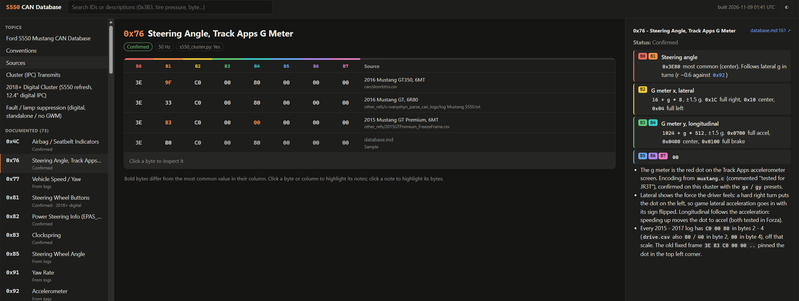
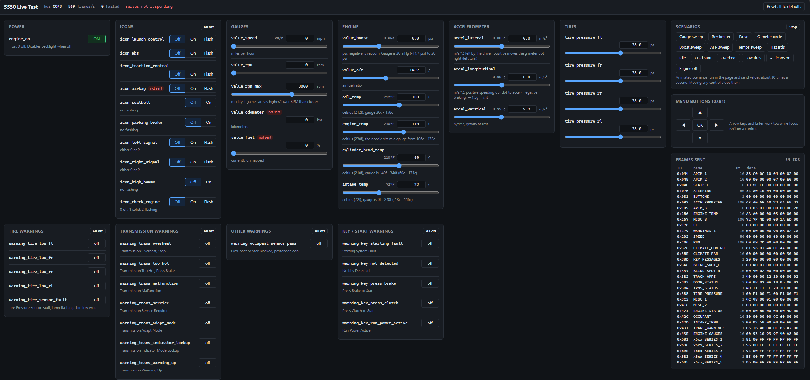

# Ford Mustang (S550) CAN Bus Research & Scripts

Scripts and hours of trial and error mapping the Ford Mustang S550 (2015-2023) CAN bus. Most of my research was intended so I could use my IPC (speedometer / cluster) when playing racing games. 



- **[CAN database](https://ericturner3.github.io/s550-canbus/)**: every message, byte by byte, searchable. Built from
  [database/](database/) (one file per cluster or module) and the logs in [canbus_samples/](canbus_samples/).
- **Want to help?** See [CONTRIBUTING.md](CONTRIBUTING.md). The minimum is one markdown file.

## What you need

- USB-to-CAN adapter, e.g. a [CANable](https://openlightlabs.com/collections/frontpage/products/canable-0-4)
- 12 V power supply (a 5.5 x 2.1 mm barrel plug with [screw terminals](https://www.amazon.com/dp/B079RBL339) is easy)
  and some [jumper wires](https://www.amazon.com/dp/B01EV70C78)
- An S550 cluster (under $100 on eBay). Built and tested on a 2015-17 analog, a 2018+ digital may partly work
- Python 3 and `pip install -r requirements.txt`

| Pin | Instrument cluster | APIM (SYNC 2 / 3) |
|---|---|---|
| 12 V | 8 | 1 |
| Ground | 3 | 37 |
| CAN High (to the adapter) | 12 | 19 |
| CAN Low (to the adapter) | 13 | 20 |

## Quick start

```
python ports.py                   # find the adapter's COM port
python live_test.py               # sliders for every gauge and light, opens http://127.0.0.1:8550
python s550_cluster.py simhub     # or play a game on it
```

## Scripts

| Script | What it does |
|---|---|
| `s550_cluster.py <game>` | Runs the cluster from a game: `fh5` (Forza Horizon 5), `ats` (American / Euro Truck Simulator 2), `simhub` (anything [SimHub](https://www.simhubdash.com/) reads). Videos: [v1](https://youtu.be/KNyn1v3_cwc), [v2](https://www.youtube.com/shorts/0d_nqnypM2c) |
| `live_test.py` | Web UI with a slider or button for every value, no game needed |
| `interactive_brute_force.py` | Sweeps one signal while sending everything else, to see what changes. [Video](https://youtu.be/OzUs28GIq0A) |
| `fake_forscan.py` | Lets [Forscan](https://forscan.org/) talk to a bench cluster (DTCs, as-built) |
| `ipc_dtc_test.py` | Reads and clears the cluster's DTCs, finds which frames keep a code away |
| `build_web.py` | Builds the database site in `docs/`. `--check` checks the database format |
| `replay.py` | Replays a CAN log to the cluster (doesn't quite work yet) |
| `decode_can_log.py` | Turns a python-can log's base64 data into readable bytes |
| `ports.py` | Lists serial ports, to find the adapter |

`s550_data.py` is the model games fill in: add a custom game by writing its values there (see `games/`). I strongly encourage using `simhub` first unless the game is unsupported by SimHub.

<details>
<summary><b>s550_cluster.py</b>: SimHub setup</summary>

`python s550_cluster.py simhub` works with any game SimHub reads. Turn on SimHub's web server (Settings > General,
port 8888). No SimHub device or dashboard needed.

</details>

<details>
<summary><b>live_test.py</b>: options</summary>



Shows every frame being sent (changed bytes highlight), canned scenarios (gauge sweep, drive cycle, g-meter circle,
hazards, low tires...) and the menu buttons.

```
python live_test.py --virtual       # no CAN adapter
python live_test.py --com COM5      # another port
python live_test.py --dummydata     # add the chassis messages
```

</details>

<details>
<summary><b>interactive_brute_force.py</b>: examples</summary>

Arrow keys and enter drive the cluster's menu, space pauses the sweep, + / - step the value, r resets it. Every preset
and option: `python interactive_brute_force.py --help`.

```
python interactive_brute_force.py afr                                  # sweep the AFR gauge
python interactive_brute_force.py epasbyte1 --dummydata                # 0x82 byte 1, power steering frames sent alongside
python interactive_brute_force.py cht --dummydata --respond --freeze   # steady chassis data, answer the cluster's startup requests
python interactive_brute_force.py cht --gt-only 0x421,0x434            # add frames from v-ivanyshyn's GT log
python interactive_brute_force.py afr --dummydata --mute 0x82,0x85     # stop sending IDs to find which one raises a warning
python interactive_brute_force.py idle --dummydata --respond --config --vin 1FA6P8... --speed 0   # a steady parked car
```

</details>

<details>
<summary><b>fake_forscan.py</b>: setup and examples</summary>

Runs `interactive_brute_force.py` (test `idle`, speed 0) and answers Forscan as the PCM and BCM, so Forscan finds a
car. The real cluster answers for itself. Every other option goes to `interactive_brute_force.py`.

- Wire the ELM327 (one with the HS / MS switch Forscan uses) straight to the cluster's CAN pins, Forscan doesn't look
  for the cluster on the OBD port's HS1 pins
- Prints each diagnostic frame with the module's name, e.g. `- diag 0x728 (IPC - Instrument Panel Cluster reply): ...`
- This is how the Steering Assist Fault was fixed: EPAS turned off in the cluster's as-built, see IPC As-Built in
  [database.md](database/database.md)

```
python fake_forscan.py --dummydata --respond --config --vin 1FA6P8...
python fake_forscan.py --dummydata --respond --config --vin 1FA6P8... --modules 0x726,0x7E1,0x7D0   # fake more modules
python fake_forscan.py --dummydata --respond --vin 1FA6P8... --status                              # show the frames/s line
```

</details>

<details>
<summary><b>ipc_dtc_test.py</b>: examples</summary>

Talks UDS to the cluster on `0x720` / `0x728`.

```
python ipc_dtc_test.py read
python ipc_dtc_test.py clear                                  # clear, wait, read back what re-set
python ipc_dtc_test.py probe 085roll 3A8=0000278F00000000@20
python ipc_dtc_test.py scan dummy batch=64 000-3FF            # hold unsent IDs, bisect to the one that clears a code
python ipc_dtc_test.py mute dummy                             # stop frames we send, find the ones a code needs
python ipc_dtc_test.py sweep 42C dummy off 9000FF009C600000   # one ID, one payload after another
python ipc_dtc_test.py watch zeros dummy                      # no DTCs: change one ID at a time, watch the cluster
```

</details>

## References

- [v-ivanyshyn's Ford CAN IDs summary](https://github.com/v-ivanyshyn/parse_can_logs/blob/master/Ford%20CAN%20IDs%20Summary.md):
  another GT's logs, used to line up several of ours
- [ufnalski's Ford Mustang IPC Hacking](https://github.com/ufnalski/ford_mustang_cluster_h503rb): found the message
  that enables Track Apps
- [roxasthenobody98's Simulink-Model-Generation-Tool](https://github.com/roxasthenobody98/Simulink-Model-Generation-Tool/):
  has a `VehicleCAN.dbcx`, which looks like a 2019 Ford DBC
