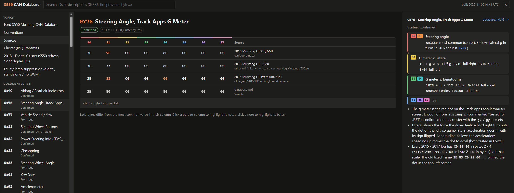
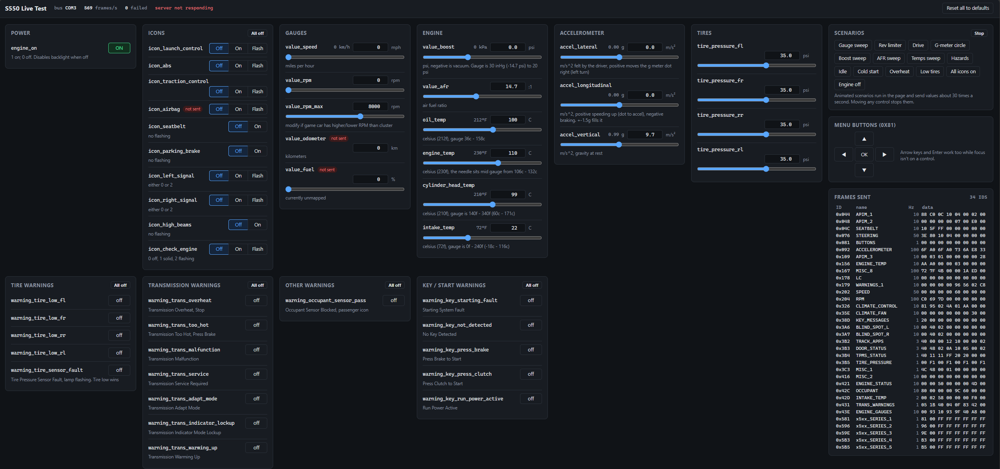

Ford Mustang (S550) CAN Bus Research & Scripts
===

This repo serves as a compendium of scripts and hours of trial/error research to try and map the S550 canbus, specifically towards the IPC.

The [database.md](database.md) file contains all the research on the CAN messages in one place. 

A more interactive [web view](https://ericturner3.github.io/s550-canbus/) is also available.

Main Scripts
* s550_cluster.py <game> - Currently supports Forza Horizon 5, American Truck Simulator & Euro Truck Simulator 2 in an alpha state. Allows that game to interface with the cluster. See s550_data.py for the model in translating other game data
    * [Video Demonstration](https://youtu.be/KNyn1v3_cwc)
    * [Video Demonstration v2](https://www.youtube.com/shorts/0d_nqnypM2c) - 7 November 2026, shows new AFR, Boost, Inlet Air Temp, Track Apps Accelerometer gauges
* interactive_brute_force.py - This script allows you to use the up,down,left,right,enter keys to control the menu on the cluster
    * arrows.py and brute_force.py were merged into a single interactive script
    * [Video Demonstration](https://youtu.be/OzUs28GIq0A)

* live_test.py - Local web UI with sliders / buttons for every value in s550_data.py, sent to the cluster live so you can check gauges, icons and warnings without a game. Run `python live_test.py` and it opens http://127.0.0.1:8550
    * Shows every frame being sent (byte changes highlight), canned scenarios (gauge sweep, drive cycle, g-meter circle, hazards, low tires...) and the menu buttons
    * `--virtual` runs without the CAN adapter, `--com COM5` picks another port, `--dummydata` adds the chassis messages like interactive_brute_force.py

Supporting Scripts
* ports.py - Script that was pulled from StackOverflow to show which port the USB-to-CAN interface is running on. Required to communicate with the IPC
* decode_can_log.py - Takes a CANdump from the can folder and converts the b64 data string to a more easily readable byte array
* replay.py - Attempt to replay data from the CANdump at a slower pace to determine functionality (doesn't quite work)
* build_web.py - Builds the searchable database viewer in `docs/` from database.md and the logs. Run `python build_web.py` and open `docs/index.html` (no server or installs needed). GitHub Pages rebuilds it on every push to master

Requirements:
* USB-to-CAN adapter. I am using a [CANable](https://openlightlabs.com/collections/frontpage/products/canable-0-4)
* Wires / [Breadboard Wires](https://www.amazon.com/dp/B01EV70C78)
* 12v power supply (I had one laying around with a 5.5mm x 2.1mm plug barrel on the end)
    * You can wire one of the female connectors from [here](https://www.amazon.com/dp/B079RBL339) to allow for easy plug and play.
* S550 Cluster (you can find them for under $100 on eBay.)
    * I am unsure of the digital clusters functionality, some data should be shared so it should work in an alpha state.
* Python, PIP, & Packages in the requirements.txt file

Booting Your Device:
* APIM / SYNC2 / SYNC3
    * Pin 1 - 12V
    * Pin 37 - Ground
    * Pin 19 - HSCAN High (goes to USB-to-CAN adapter)
    * Pin 20 - HSCAN Low (goes to USB-to-CAN adapter)
* Instrument Cluster
    * Pin 8 - 12V
    * Pin 3 - Ground
    * Pin 12 - HSCAN High (goes to USB-to-CAN adapter)
    * Pin 13 - HSCAN Low (goes to USB-to-CAN adapter)

References
* [v-ivanyshyn's Ford CAN IDs summary](https://github.com/v-ivanyshyn/parse_can_logs/blob/master/Ford%20CAN%20IDs%20Summary.md)
    * this helped me correlate several other logs using another GT's data
* [ufnalski's Ford Mustang IPC Hacking](https://github.com/ufnalski/ford_mustang_cluster_h503rb)
    * helped find the message to enable track apps!
* [roxasthenobody98's Simulink-Model-Generation-Tool](https://github.com/roxasthenobody98/Simulink-Model-Generation-Tool/) has a repo with a VechicleCAN.dbcx which appears to be 2019 DBC database for reversing.